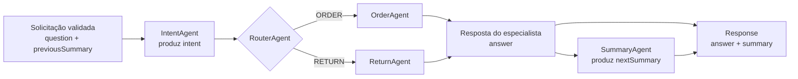

# Aplicações agênticas com Helidon AI

Este laboratório acompanha o artigo **Criando agentes de forma simplificada com Helidon AI**. O objetivo é mostrar como construir uma aplicação agêntica em Java com interfaces, anotações e componentes nomeados, mantendo explícitos os contratos, o acesso a dados e os controles da aplicação.

O caso de uso é o atendimento da loja fictícia **Trilha**: consultar pedidos e orientar trocas. A implementação principal utiliza **Helidon SE, virtual threads e LangChain4j**, integrada ao **OCI Generative AI**. As versões em Python e Go reproduzem o cenário e os contratos para permitir uma comparação das aplicações completas.

O propósito da comparação é incluir Java entre as opções de stack para aplicações agênticas. A decisão também depende do ecossistema, da maturidade das integrações, da experiência da equipe e da operação do serviço.

## Por onde começar

1. Siga o [laboratório Java](java/README.md) para compilar, preparar os índices, iniciar o MCP e executar o assistente.
2. Leia a [configuração OCI](#autenticação-na-oci) antes de iniciar o processo do assistente.
3. Faça uma chamada de negócio com uma das [rotas HTTP](#api-http). Depois, utilize o [plano JMeter](jmeter/agentic.jmx).
4. Para as outras implementações, siga os guias de [Python](python/README.md) e [Go](go/README.md). Prepare também os [assets compartilhados](comparison/assets/README.md).

O código Java fixa **Helidon 4.5.6**, **LangChain4j 1.18.1** e **MCP 1.2.0**, incluindo os módulos beta gerenciados pelas dependências. Use JDK 21 de 64 bits e Maven 3.9.9 ou superior. Python utiliza a linha 3.13; os requisitos de Go, CGO e biblioteca ONNX estão no guia correspondente.

## Do serviço simples à composição de agentes

A progressão didática começa em [PolicyService](java/assistant/src/main/java/lab/trilha/ai/PolicyService.java), um AI Service com modelo, políticas e ferramenta. Essa é a entrada de `/api/v1/direct`.

O [SupportWorkflow](java/assistant/src/main/java/lab/trilha/ai/SupportWorkflow.java) acrescenta classificação, roteamento e atualização do resumo:



O modelo classifica a solicitação como `ORDER` ou `RETURN`. As condições Java do roteador selecionam o especialista; a sequência termina com o novo resumo. Os valores `intent`, `answer` e `nextSummary` são compartilhados no `AgenticScope` daquela execução.

Há uma alternativa com [SupportSupervisor](java/assistant/src/main/java/lab/trilha/ai/SupportSupervisor.java): o modelo escolhe os especialistas, com `maxAgentsInvocations = 3`. Esse limite se refere às invocações dos subagentes, não ao total de chamadas ao provedor. O [SupervisorWorkflow](java/assistant/src/main/java/lab/trilha/ai/SupervisorWorkflow.java) mantém a atualização do resumo como etapa posterior fixa.

## Capacidades declaradas no Java

| Capacidade | Como aparece no laboratório |
|---|---|
| Serviço e agentes | `@Ai.Service`, `@Ai.Agent` e `@Ai.ChatModel` associam interfaces e modelos nomeados. |
| Mensagens e contratos | `@SystemMessage`, `@UserMessage`, `@V` e `outputKey` definem instruções, entradas e resultados da composição. |
| Ferramenta local | `@Ai.Tools(OrderTools.class)` disponibiliza a consulta `findOrder`, descrita com `@Tool` e `@P`. |
| RAG | `@Ai.ContentRetriever("orders")` e `@Ai.ContentRetriever("returns")` associam políticas aos especialistas. |
| Guardrails | `@InputGuardrails` e `@OutputGuardrails` associam as verificações implementadas em Java. |
| Workflow | `@SequenceAgent`, `@ConditionalAgent`, `@ActivationCondition` e `@Output` expressam a sequência e suas condições. |
| Supervisor | `@SupervisorAgent` e `@SupervisorRequest` definem a delegação orientada pelo modelo. |
| MCP | `@Ai.McpClients("order-server")` conecta o especialista ao servidor de ferramentas. |

### Conhecimento, dados de pedidos e contexto

O **RAG fornece políticas** de entrega e troca. A [ingestão](java/assistant/src/main/java/lab/trilha/rag/IngestPolicies.java) gera os índices a partir de [orders.md](java/knowledge/orders.md) e [returns.md](java/knowledge/returns.md), com um bloco por documento. O modelo MiniLM calcula os embeddings localmente; os modelos de geração são acessados na OCI.

O **status do pedido vem da ferramenta**, que consulta o [OrderCatalog](java/domain/src/main/java/lab/trilha/domain/OrderCatalog.java). O catálogo fictício aceita `TR-1001` e `TR-1002` e aplica as mesmas regras nas ferramentas locais e MCP. A operação é somente de leitura; o assistente não aprova trocas nem executa estornos ou alterações.

O **contexto da conversa é explícito**: o cliente envia `summary`, e o workflow devolve seu próximo valor. Para continuar o atendimento, o cliente precisa reenviá-lo. Não há gerenciamento de sessões persistentes nem um `ChatMemoryProvider` configurado pela aplicação. `/api/v1/direct` devolve o resumo vazio.

### Guardrails e fronteiras

O endpoint valida o contrato HTTP: mensagem não vazia com até 2.000 pontos de código Unicode e resumo com até 1.500. [RequestGuardrail](java/assistant/src/main/java/lab/trilha/guardrail/RequestGuardrail.java) bloqueia os marcadores de chaves privadas previstos no código. [AnswerGuardrail](java/assistant/src/main/java/lab/trilha/guardrail/AnswerGuardrail.java) rejeita respostas vazias, excessivas ou com determinadas expressões bloqueadas.

Esses guardrails retornam falha fatal, sem solicitar nova geração para corrigir a resposta. A ferramenta também valida os argumentos no catálogo e devolve erros controlados. São regras didáticas e determinísticas; proteção contra outras formas de exposição de dados ou prompt injection exige avaliação e controles próprios.

## Estrutura do repositório

```text
.
├── java/          # Helidon: assistant, domain, mcp-server, políticas e contratos
├── python/        # FastAPI, asyncio, RAG local e MCP
├── go/            # HTTP, goroutines, RAG local e MCP
├── comparison/    # Prompts/schemas compartilhados e preparação dos assets ONNX
├── jmeter/        # Plano único de verificação HTTP e carga
└── docs/          # Comparação manual e instalação em VMs Oracle Linux
```

Os caminhos desta página são relativos à raiz do repositório. A pasta clonada pode ter qualquer nome. As pastas `comparison` e `java/knowledge` guardam os contratos, as políticas e os índices usados pelas três implementações; preserve essa organização ao copiar os laboratórios. Python e Go leem esses arquivos como dados e executam o atendimento em seus próprios runtimes. Ambientes virtuais, SDKs, caches, builds e assets binários preparados localmente ficam fora do Git pelas regras de `.gitignore`; os guias explicam como prepará-los em um clone novo.

### Servidores MCP e caminhos compartilhados

Cada linguagem tem seu próprio servidor MCP: Java em `java/mcp-server`, Python em `python/trilha/mcp_server` e Go em `go/cmd/mcp-server`. Os guias de execução usam o servidor da respectiva linguagem. Também é possível apontar os três assistentes para um mesmo servidor MCP; essa opção serve para comparar clientes com uma dependência externa comum.

O assistente Go usa `LAB_ROOT=<raiz>/java` porque procura os índices em `LAB_ROOT/knowledge`. Esse caminho indica uma pasta de dados, sem iniciar código Java. O servidor MCP Go lê apenas o contrato: com `CONTRACT_PATH` explícito, não precisa de `LAB_ROOT`. No Python, `LAB_ROOT` indica a raiz do repositório, de onde o pacote localiza o contrato e, no assistente, os índices.

## Autenticação na OCI

As três aplicações usam **Chat Completions compatível com OpenAI**, com Bearer token. A credencial é um dos segredos ativos de uma **API key criada no serviço Generative AI**, na mesma região do modelo. A política IAM precisa autorizar o principal `generativeaiapikey` no escopo utilizado.

| Variável | Valor |
|---|---|
| `OCI_BASE_URL` | URL regional terminada em `/20231130/actions/v1`; o cliente acrescenta `/chat/completions`. |
| `OCI_API_KEY` | Somente o segredo da API key do Generative AI. |
| `OCI_ROUTING_MODEL` | Identificador do modelo para classificação e resumo. |
| `OCI_EXPERT_MODEL` | Identificador do modelo para especialistas e supervisor. |

No terminal do assistente, Linux/Bash:

```bash
export OCI_BASE_URL='https://inference.generativeai.us-chicago-1.oci.oraclecloud.com/20231130/actions/v1'
read -rsp 'Segredo da API key GenAI: ' OCI_API_KEY
echo
export OCI_API_KEY
export OCI_ROUTING_MODEL='<identificador do modelo de classificação e resumo>'
export OCI_EXPERT_MODEL='<identificador do modelo dos especialistas>'
```

Configure essas variáveis **antes de iniciar o assistente**. Os guias de cada linguagem apresentam os comandos Linux, PowerShell e Git Bash aplicáveis. A URL acima é um exemplo para Chicago; use uma região compatível com sua chave e seus modelos. Os nomes usados no ensaio do artigo foram `openai.gpt-oss-20b` e `openai.gpt-oss-120b`; confirme a disponibilidade e as permissões na sua conta.

Esta implementação não recebe `OCI_COMPARTMENT_ID`, não lê `[DEFAULT]`/PEM de `~/.oci/config` e não usa Instance Principal. O compartimento continua relevante à criação e à autorização da API key. Os processos **não carregam `.env` automaticamente**. Guarde o segredo no ambiente local e não o inclua nos arquivos versionados.

Consulte [API keys do Generative AI](https://docs.oracle.com/en-us/iaas/Content/generative-ai/api-keys.htm) e [permissões IAM da chave](https://docs.oracle.com/en-us/iaas/Content/generative-ai/add-api-permission.htm).

## Executar e chamar a aplicação

| Implementação | Guia de execução | Assistente HTTP | MCP nativo |
|---|---|---:|---:|
| Java / Helidon e virtual threads | [Java](java/README.md) | 8080 | 8081 |
| Python / asyncio | [Python](python/README.md) | 8082 | 8083 |
| Go / goroutines | [Go](go/README.md) | 8084 | 8085 |

Nos guias, a preparação segue esta ordem: compilar ou instalar as dependências, preparar os índices/assets necessários, iniciar o MCP, configurar a OCI e iniciar o assistente. Os clientes MCP são inicializados na subida do assistente; mantenha o servidor configurado disponível mesmo para testar uma rota com ferramenta local.

O bind padrão é `127.0.0.1`. Os guias explicam como permitir acesso ao JMeter externo. Java inclui os JARs de dependências no build; Python e Go precisam também dos [assets ONNX preparados manualmente](comparison/assets/README.md).

### API HTTP

| Método e rota | Comportamento |
|---|---|
| `POST /api/v1/direct` | AI Service com políticas de troca e ferramenta; resumo retornado vazio. |
| `POST /api/v1/workflow` | Classificação → especialista selecionado → atualização do resumo. |
| `POST /api/v1/supervisor` | Supervisor → especialistas → síntese → atualização do resumo. |
| `POST /api/v1/mcp` | Especialista de pedidos com ferramenta MCP → atualização do resumo. |
| `GET /health` | Verifica se o processo responde. |
| `GET /api/v1/runtime` | Informa a versão do runtime e dados de execução. |
| `GET /api/v1/metrics` | Expõe contadores cumulativos de chamadas, erros, tokens informados e solicitações de ferramentas. |

Com Java em execução:

```bash
curl -sS http://127.0.0.1:8080/api/v1/workflow \
  -H 'Content-Type: application/json' \
  -d '{"message":"Qual o status do pedido TR-1001?","summary":""}'
```

No Windows, use `curl.exe`. A resposta de negócio contém `answer` e `summary`. Para Python e Go, troque a porta. Os [contratos HTTP e de comportamento](java/contracts/BEHAVIOR.md) detalham o cenário.

## Verificar comportamento e comparar as implementações

O [JMX único](jmeter/agentic.jmx) verifica HTTP 200, `answer` não vazio e `summary` como string. Uma expressão opcional permite conferir conteúdo. A correção do atendimento deve ser avaliada contra o catálogo e as políticas; a aprovação dessas assertions não comprova qualidade semântica.

O [guia de comparação manual](docs/COMPARACAO_MANUAL.md) descreve aquecimento, carga, repetições, contadores de modelo e coleta de CPU/memória. O [guia de três VMs Oracle Linux](docs/BENCHMARK_ORACLE_LINUX.md) apresenta instalação, envio dos arquivos, configuração e inicialização, com uma VM por linguagem.

O benchmark do artigo usa `/api/v1/workflow`, cujas ferramentas são locais. CPU e memória são coletadas apenas do PID do assistente de cada linguagem; o processo do servidor MCP fica fora dessa coleta. O assistente ainda mantém a conexão MCP inicializada e suas verificações periódicas. Caso os dois processos estejam na mesma VM, compartilham os recursos da máquina.

A latência HTTP inclui o atendimento completo, com classificação, RAG, ferramentas, resumo e espera pela OCI. Para avaliar a rota `/api/v1/mcp`, faça um ensaio separado: seu tempo inclui a comunicação e a execução no servidor MCP. Colete os PIDs do assistente e do servidor separadamente.

O benchmark do artigo é exploratório e foi condicionado por respostas HTTP 429 do provedor na conta trial. Tempos e vazão agregados incluem essas falhas. Os resultados ajudam a discutir as implementações naquele cenário; não estabelecem superioridade geral de uma linguagem nem substituem uma avaliação com os requisitos da aplicação.

## Referências e atribuições

- [Integração Helidon e LangChain4j](https://helidon.io/docs/v4/se/ai/langchain4j).
- [Agentes e composição no LangChain4j](https://docs.langchain4j.dev/tutorials/agents/).
- [HOL oficial usado como referência técnica](https://github.com/helidon-io/helidon-labs/tree/3d8f16caaa16958debe07cef681c819c87f83d5d/hols/langchain4j-agentic).
- [Helidon MCP 1.2.0](https://github.com/helidon-io/helidon-mcp/tree/1.2.0).

O domínio Trilha e seus dados são fictícios e pertencem ao laboratório. Prompts internos de planejamento reproduzidos nas versões Python e Go continuam atribuídos ao LangChain4j; a [descrição dos recursos compartilhados](comparison/README.md) registra essa origem. Consulte também as [atribuições e licenças de terceiros](THIRD_PARTY_NOTICES.md). As políticas de troca não representam regras de uma loja real.
